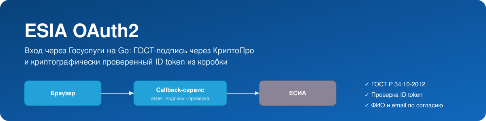
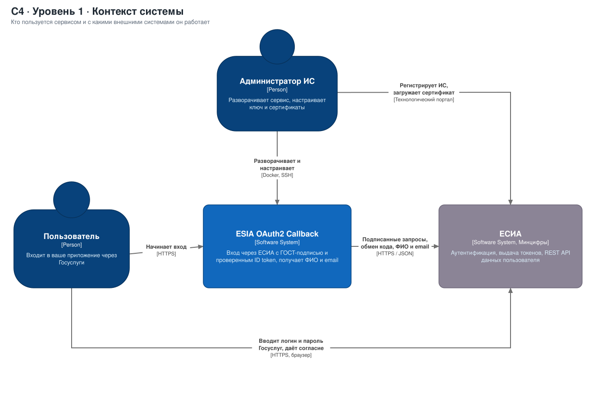
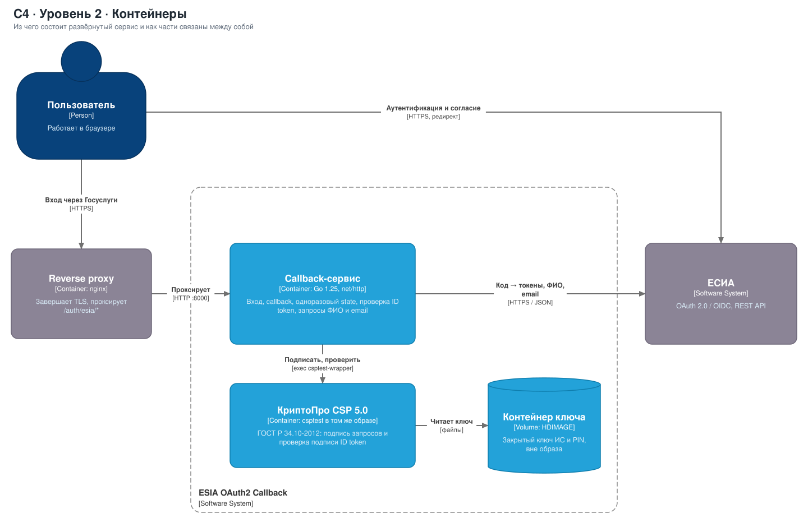
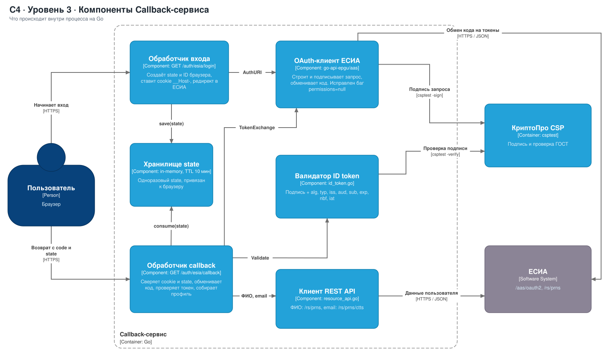
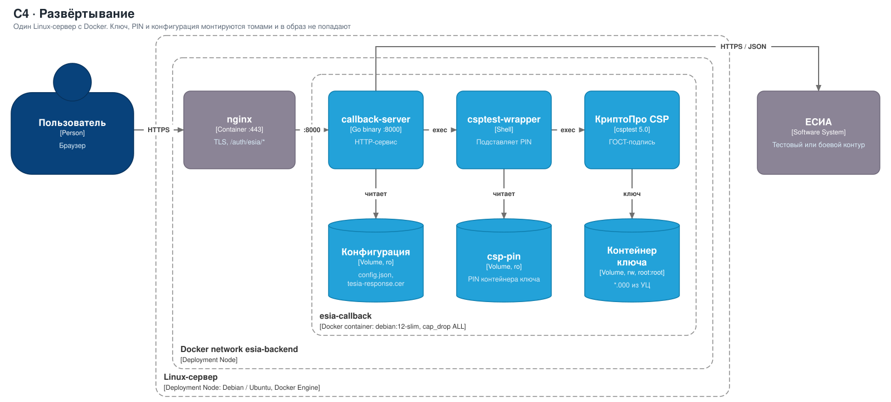
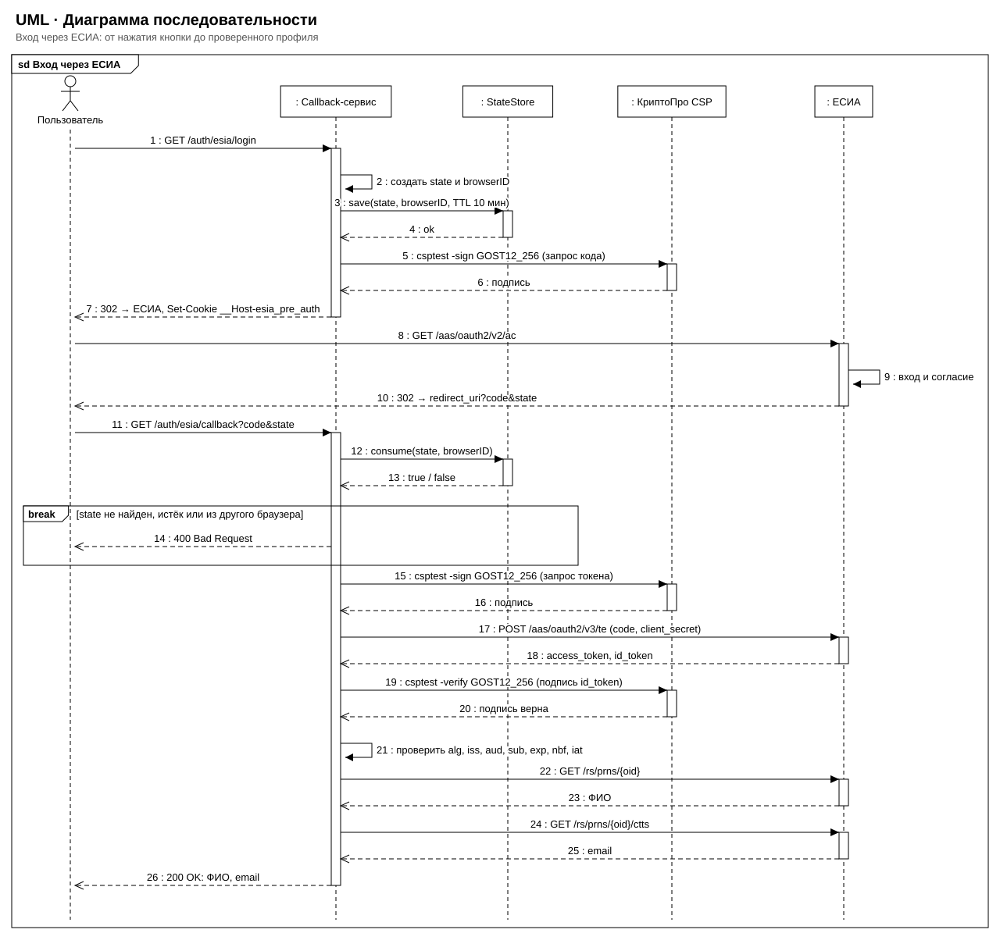

<div align="center">



**Вход через Госуслуги (ЕСИА) для Go-проектов: готовый сервис с ГОСТ-подписью
через КриптоПро и проверенным ID token**

[](https://github.com/AlchemistBro/esia-oauth2/actions/workflows/ci.yml)
[](https://github.com/AlchemistBro/esia-oauth2/releases)
[](https://go.dev/)
[](./LICENSE)

[Быстрый старт](#быстрый-старт) ·
[Почему не просто библиотека](#почему-не-просто-библиотека) ·
[Архитектура](#архитектура) ·
[Документация](./docs/ru/index.md)

</div>

> Независимый проект. Не является официальным продуктом ЕСИА, Минцифры России
> или КриптоПро.

## Главное

Обычная интеграция с ЕСИА заканчивается на строке `id_token`, которой
приходится верить на слово. Этот сервис доводит вход до конца: проверяет
ГОСТ-подпись токена средствами КриптоПро, сверяет все обязательные claims,
защищает callback одноразовым state, привязанным к браузеру, и по согласию
пользователя получает его ФИО и email. Токены браузеру не передаются.

Снаружи это два HTTP-эндпоинта за вашим nginx:

| Эндпоинт | Что делает |
|---|---|
| `GET /auth/esia/login` | Создаёт state, подписывает запрос ГОСТ-подписью и отправляет пользователя в ЕСИА |
| `GET /auth/esia/callback` | Проверяет state и cookie, обменивает код, проверяет ID token, возвращает ФИО и email |

## Почему не просто библиотека

Сервис построен поверх [`go-api-epgu`](https://github.com/ofstudio/go-api-epgu)
(`esia/aas` и `esia/signature`). Это хорошая библиотека для API Госуслуг, но
OAuth-часть в ней низкоуровневая: она строит URL, обменивает код и отдаёт
токен строкой. Всё, что отделяет пример от рабочего входа, остаётся на вас.
Здесь это уже сделано:

| | `go-api-epgu` | `esia-oauth2` |
|---|---|---|
| **Подпись ID token** | не проверяется, `IdToken` приходит строкой | проверяется: ГОСТ Р 34.10-2012 через `csptest` или RS256 |
| **Claims ID token** | не проверяются | `alg`, `typ`, `iss`, `aud`, `sub`, `exp`, `nbf`, `iat` с допуском 60 с |
| **Защита callback (CSRF)** | `ParseCallback` возвращает state, хранить и сверять его нужно самому | серверный state: одноразовый, TTL 10 минут, привязан к браузеру через cookie `__Host-` |
| **`permissions=nil`** | в v0.5.0 добавляет `permissions=bnVsbA` (JSON `null`), ЕСИА отвечает ошибкой | пустой параметр удаляется, настоящие permissions сохраняются байт в байт, дубли отклоняются |
| **PIN контейнера ключа** | `csptest` вызывается без пароля, контейнер с PIN не подписывает | [обёртка](./deploy/csptest-wrapper.sh) подставляет PIN из файла-секрета |
| **ФИО и email** | нет | согласие `APIPGU` и REST API ЕСИА (`/rs/prns`, `/ctts`) |
| **Форма поставки** | Go-пакет | HTTP-сервис, Dockerfile, hardened Compose, пример nginx |
| **КриптоПро в Docker** | не описано | права при `cap_drop: ALL`, лицензия, диагностика подписи |

Самое ценное здесь проверка подписи ID token. ЕСИА кладёт ГОСТ-подпись в JWT
в порядке байтов big-endian, а `csptest` ждёт обратный. Если об этом не знать,
каждый честный токен выглядит поддельным, и проверку обычно просто выключают.
Здесь подпись разворачивается и проверяется на каждом входе, а при любой
ошибке сервис отказывает во входе.

## Архитектура

| Уровень | Схема |
|---|---|
| Контекст | [](./docs/assets/c4-1-context.svg) |
| Контейнеры | [](./docs/assets/c4-2-containers.svg) |

<details>
<summary><b>Компоненты, развёртывание и последовательность входа</b></summary>







</details>

Исходники схем в формате draw.io лежат в [`docs/diagrams`](./docs/diagrams).
Подробное описание потока: [архитектура](./docs/ru/architecture.md).

## Что понадобится

- Linux-сервер с Docker и Docker Compose;
- КриптоПро CSP 5.0 для Linux amd64: `.deb`-пакеты с
  [cryptopro.ru](https://cryptopro.ru/products/csp/downloads), в репозиторий
  они не входят по условиям лицензии;
- информационная система, зарегистрированная на технологическом портале ЕСИА,
  с загруженным клиентским сертификатом;
- контейнер закрытого ключа (`*.000`) и PIN к нему;
- публичный сертификат TESIA выбранного контура;
- домен с HTTPS и nginx перед сервисом.

## Быстрый старт

```bash
git clone https://github.com/AlchemistBro/esia-oauth2.git
cd esia-oauth2

# 1. Пакеты КриптоПро
mkdir -p deploy/cryptopro && cp /path/to/cryptopro/*.deb deploy/cryptopro/

# 2. Конфигурация
cp config.example.json config.json   # заполните поля, см. docs/ru/configuration.md

# 3. Секреты и сертификаты (в Git не попадают)
mkdir -p certs secrets
cp /path/to/tesia.cer certs/tesia-response.cer
cp -r /path/to/xxxxxxxx.000 secrets/key-container
printf '%s' 'PIN' > secrets/csp-pin
sudo chown -R root:root secrets
sudo chmod 700 secrets/key-container
sudo chmod 600 secrets/key-container/* secrets/csp-pin

# 4. Сборка и запуск
docker compose -f compose.example.yaml up -d --build
```

Проверьте, что КриптоПро видит ключ и умеет подписывать:

```bash
docker exec esia-callback /opt/cprocsp/bin/amd64/csptest -keyset -enum_cont -fqcn -verifyc
```

Затем настройте nginx ([пример](./docs/ru/deployment.md#пример-nginx)) и
откройте `https://ваш-домен/auth/esia/login`. После входа на Госуслугах
callback вернёт `HTTP 200` с ФИО и email.

### `cert_hash` и `csp_container`

```bash
# хеш клиентского сертификата для cert_hash
/opt/cprocsp/bin/amd64/cpverify -mk client.cer -alg GR3411_2012_256

# имя контейнера для csp_container
/opt/cprocsp/bin/amd64/csptest -keyset -enum_cont -fqcn -verifyc
```

## Конфигурация

Минимальный вход только с подтверждением личности:

```json
{
  "redirect_uri": "https://service.example.com/auth/esia/callback",
  "mnemonic": "DEMO_CLIENT",
  "esia_uri": "https://esia-portal1.test.gosuslugi.ru",
  "csp_test_path": "/usr/local/bin/csptest-wrapper",
  "csp_container": "00000000-0000-0000-0000-000000000000",
  "cert_hash": "<64 hex-символа>",
  "http_listen_addr": ":8000",
  "esia_response_cert_path": "/app/certs/tesia-response.cer",
  "id_token_algorithm": "GOST3410_2012_256",
  "id_token_issuer": "http://esia-portal1.test.gosuslugi.ru/",
  "oauth": { "scopes": ["openid"] }
}
```

Чтобы получать ФИО и email, добавьте блок `consent` из
[`config.example.json`](./config.example.json). Все поля и правила проверки
описаны в [документации по конфигурации](./docs/ru/configuration.md). Ошибка
в конфигурации останавливает запуск сразу, а не на первом пользователе.

## Проверка

```bash
test -z "$(gofmt -l *.go)"
go vet ./...
go test -race ./...
go build ./...
```

Те же шаги выполняет CI на каждый push. В тестах есть негативные сценарии:
повтор state, чужой браузер, просроченный state, подмена `alg`, `iss`, `aud`,
истёкший токен, неверная подпись.

## Документация

| Раздел | О чём |
|---|---|
| [Начало работы](./docs/ru/getting-started.md) | Локальный запуск |
| [Архитектура](./docs/ru/architecture.md) | Поток входа, C4 и sequence |
| [Конфигурация](./docs/ru/configuration.md) | Все поля, согласие на ФИО и email |
| [КриптоПро и сертификаты](./docs/ru/cryptopro.md) | PIN, права, лицензия, проверка подписи |
| [Развёртывание](./docs/ru/deployment.md) | Docker Compose и nginx |
| [Безопасность](./docs/ru/security.md) | Модель угроз и ограничения |
| [Устранение неполадок](./docs/ru/troubleshooting.md) | Типовые ошибки |

## Ограничения

- state хранится в памяти: один экземпляр сервиса, перезапуск сбрасывает
  незавершённые входы;
- подпись выполняется вызовом `csptest` на каждый запрос, это подходит для
  умеренной нагрузки;
- сессию вашего приложения сервис не создаёт: после успешного callback её
  нужно выдать самостоятельно;
- TLS завершается на nginx.

## Безопасность

Не добавляйте в Git контейнеры ключей, PIN, реальный `config.json`, коды
авторизации, токены, cookies и HAR-файлы. Уязвимости сообщайте приватно по
[политике безопасности](./SECURITY.md).

## Лицензия

[MIT](./LICENSE). КриптоПро CSP распространяется по собственной лицензии
производителя и в состав проекта не входит.
